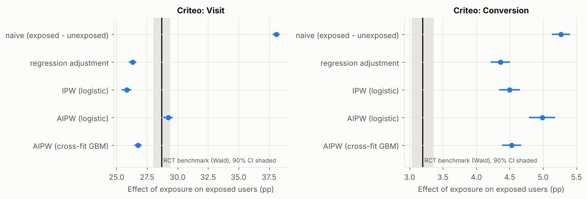
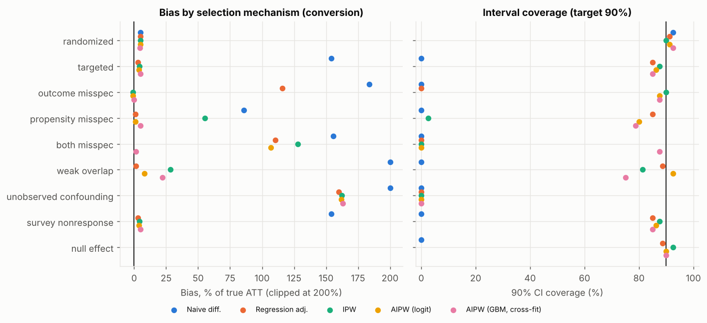
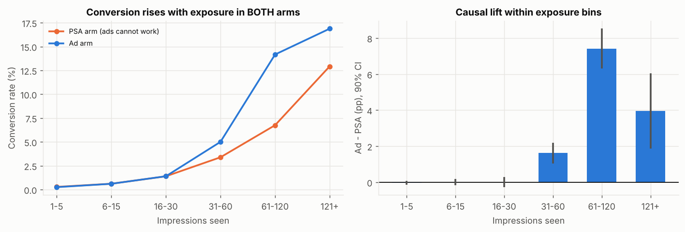
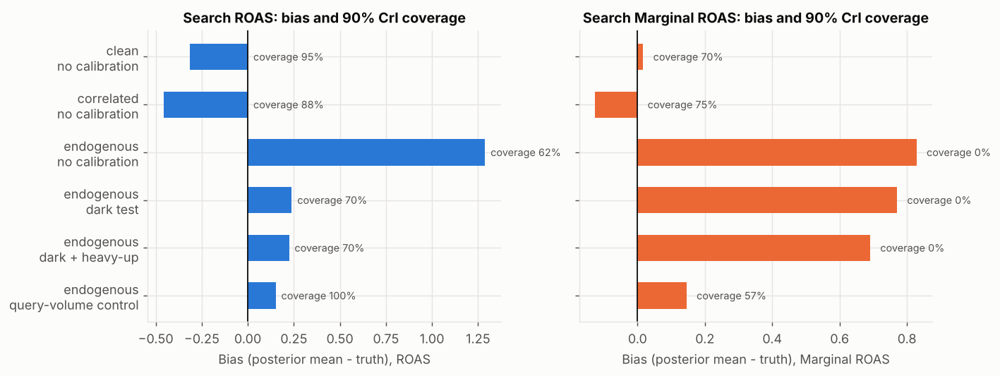
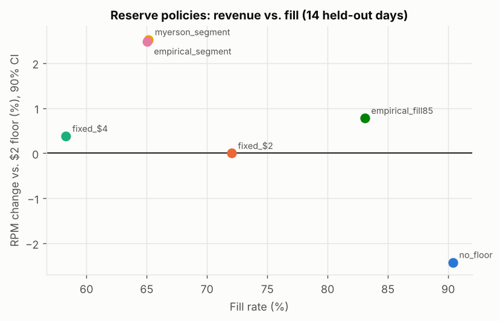
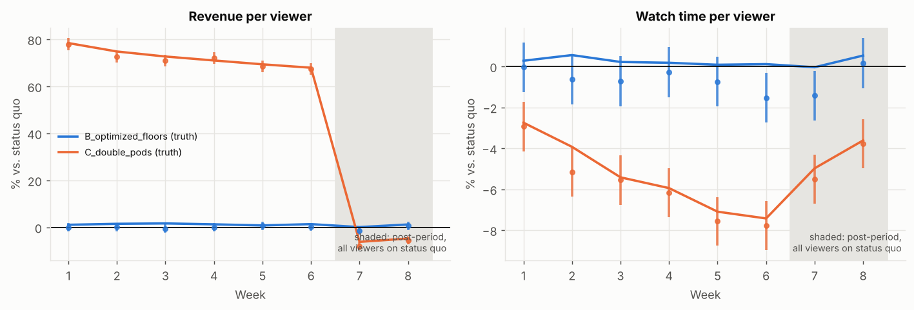
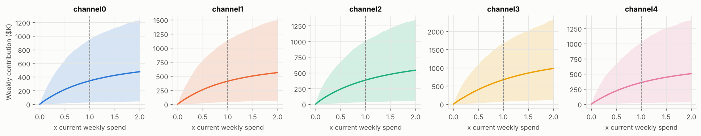

# Ad Measurement & Monetization Lab


**adlift**: incrementality, brand lift, Bayesian marketing mix modeling and reserve-price auctions for video ads,
with every method **graded against a known answer** before it is trusted.

Python · SQL (DuckDB) · PyMC · causal inference · Monte Carlo simulation

Known answers come from two places:

1. **Real randomized ad experiments**: Criteo's 13.98M-user incrementality test and a 588K-user ads-vs-PSA test.
   The randomized contrast is the yardstick observational methods must match.
2. **Simulators that return both potential outcomes**: user-level campaigns, a weekly 4-channel advertiser, and a
   paced, budgeted ad marketplace. Used only where no experiment can supply the truth.

Full results with every table: [`reports/REPORT.md`](reports/REPORT.md). Everything regenerates with `adlift all`.

## Headline results

**Observational ad measurement fails in predictable ways.** On Criteo's randomized test, comparing exposed with
unexposed users overstates the ad's effect on conversions by **1.65x**. Adjusting for all 12 available covariates
(regression, IPW, logistic and cross-fitted GBM AIPW) still leaves it **1.36 to 1.56x** too high, although for
visits AIPW lands within 2% of the experimental answer. The features explain who browses, not who buys.



**Each estimator breaks exactly where theory says.** Across 9 simulated selection mechanisms (80 campaigns each):
regression adjustment fails when the outcome model is wrong (+116% bias, 0% coverage), IPW when the propensity
model is wrong (+55%, 2%), and only cross-fitted doubly robust estimation survives both (+2%, 88%). Nothing
survives unobserved confounding. Survey nonresponse inflates naive brand lift by 58%; response weighting fixes it.



**Activity bias, measured on real users.** In the ads-vs-PSA test, users who saw no product ads still show 67%
of the heavy-vs-light-exposure conversion gap. The causal lift (+0.77pp, +43%) appears only above 30 impressions.



**MMM: selection bias, and what fixes it.** Across 40 simulated advertisers, demand-driven search budgets inflate
search's marginal ROAS by 53% with 0% interval coverage. A geo go-dark experiment fixes *average* ROAS (RMSE
1.45 to 0.51) but not *marginal* ROAS. A search-query-volume control (Chen et al. 2018) cuts marginal-ROAS bias by
82%, and its budget recommendations help in 100% of advertisers vs. 70% without it.



**Reserve prices.** Per-segment Myerson floors raise RPM **2.5%** (90% CI 2.47 to 2.57%) over a flat $2 floor
across 14 held-out days, at a 7-point fill cost and a 13% median loss of advertiser surplus, with most of the
gain from thin markets (tier-3 news: +66%). Offline replay of logged bids overstated the gain by ~40% because
budget-paced bidders react.



**Viewer guardrail.** Double ad pods raise revenue 78% in week 1, but the watch-time loss grows from **2.8% to
7.4%** by week 6 and persists after the policy is switched off, the user-learning pattern of Hohnhold, O'Brien
& Tang (2015). A one-week test would understate the harm by 2.7x. Optimized floors show no measurable viewer harm.



**MMM on Google Meridian's public data.** Beats a naive forecast on a 13-week holdout (MAPE 4.0% vs 5.4%), but
channel ROAS intervals are wide; the reallocation's expected +0.85% revenue gain is positive in only 78% of
posterior draws, so the recommendation is a geo test before moving budget.



## Repository layout

```
src/adlift/
  estimators/   difference in means, regression adjustment, IPW, AIPW (parametric + cross-fit GBM),
                Wald/IV for noncompliance, segment effects, BH, winner's curse, meta-regression
  sim/          campaign.py  user-level exposure + conversions + brand survey, both potential outcomes
                mmm.py       weekly 4-channel MMM data with exact contributions + geo experiments
  pipeline/     DuckDB runner, data-quality reports, missingness / balance / overlap / SRM diagnostics
  mmm/          adstock + Hill transforms, PyMC model with lift-test calibration, budget optimizer
  auction/      marketplace (pacing, first-price shading), reserve policies, viewer guardrail experiment
  studies/      criteo.py, ads_psa.py, meridian.py  (real public data)
  benchmark/    incrementality_mc.py, mmm_mc.py  (Monte Carlo against known truth)
  report.py, viz.py, cli.py
sql/            campaign/ (staging, analysis table, quality checks), criteo/, ads_psa/, mmm/
tests/          35 tests: estimator properties, SQL parity, quality checks, auction mechanics, MMM
reports/        REPORT.md (generated), figures/, data/ (saved results)
```

## Reproduce

```bash
git clone https://github.com/PraneethKorukonda/ad-measurement-lab.git
cd ad-measurement-lab
pip install -e ".[dev]"
adlift fetch              # ~315 MB; SHA-256 pinned
adlift all                # every study, both Monte Carlo benchmarks, then the report
pytest -m "not slow"      # ~2 min; `pytest` also runs the PyMC recovery test
```

Individual steps: `adlift pipeline | criteo | ads-psa | meridian | auction | viewer | mc-incrementality | mc-mmm | report`.
Every command saves to `reports/data/`; `adlift report` rebuilds `reports/REPORT.md` and all figures from those files.

## Design decisions worth defending

**One estimand per question.** Incrementality is the ATT of exposure (what did the ads do for the people
who saw them). The Criteo benchmark is the effect of treatment on the treated from the Wald estimator, which
is the same estimand under one-sided noncompliance, so observational estimates can be compared to it directly.
MMM quantities are ROAS (average) and marginal ROAS (next dollar), kept separate because budget decisions
need the second and most dashboards report the first.

**Standard errors from influence functions.** RA and IPW include the M-estimation correction for estimated
nuisance coefficients; AIPW uses its (orthogonal) influence function with cross-fitting. Relative lift uses
the delta method, checked against a bootstrap in the tests. Coverage is measured in the Monte Carlo rather
than assumed.

**Brand-lift surveys are a missing-data problem.** Outcomes exist only for respondents, and response depends
on exposure and engagement. Estimators take `y` with NaN and weight respondents by 1 / P(respond | x, t).

**The SQL layer is tested for parity.** A test asserts that the DuckDB pipeline, run on raw logs with
injected defects, reproduces the simulator's user table exactly. Features are computed from pre-period data
only (no post-treatment controls).

**MMM calibration with experiments, scored rather than asserted.** Lift tests enter the likelihood (the
approach used by Meridian and PyMC-Marketing). The Monte Carlo shows what that does and does not fix.

**Auction evaluation uses held-out days, paired comparisons and day-level intervals.** Offline replay of
logged bids is reported next to the online (pacing-aware) result because the gap between them is the point.

## Limitations

* Simulators encode assumptions. Every simulated result is "under this data-generating process"; the value
  is in which methods fail under which mechanism, not in the specific numbers.
* Criteo's features are anonymized projections, so the observational analysis cannot use the behavioural
  covariates a real advertiser would have. That may make observational methods look worse than they would
  with richer data, and is itself a lesson about what "adjusting for covariates" needs.
* The ads-vs-PSA dataset's provenance is undocumented. Randomization is checked (and imperfect: the arms differ
  in day/hour mix), not assumed.
* Meridian's demo data ships without its generating parameters, so that study is an applied workflow, not a
  validation. Validation lives in the MMM Monte Carlo.
* The auction is a stylized marketplace (one slot per opportunity, single-factor pacing, tier-level shading).
  Real systems add quality scores, multi-slot pods, frequency caps and learning bidders.
* The viewer model's response parameters are chosen to produce effects of a plausible size; the
  methodological result (short tests understate long-term harm, post-period holdbacks measure learning)
  does not depend on their exact values, but the magnitudes do.

## References

* LaLonde (1986), *Evaluating the Econometric Evaluations of Training Programs with Experimental Data*.
* Diemert, Betlei, Renaudin, Amini (2018), *A Large Scale Benchmark for Uplift Modeling* (Criteo dataset).
* Lewis, Rao, Reiley (2011), *Here, There, and Everywhere: Correlated Online Behaviors Can Lead to Overestimates of the Effects of Advertising*.
* Gordon, Zettelmeyer, Bhargava, Chapsky (2019), *A Comparison of Approaches to Advertising Measurement: Evidence from Big Field Experiments at Facebook*.
* Johnson, Lewis, Nubbemeyer (2017), *Ghost Ads: Improving the Economics of Measuring Online Ad Effectiveness*.
* Jin, Wang, Sun, Chan, Koehler (2017), *Bayesian Methods for Media Mix Modeling with Carryover and Shape Effects* (Google).
* Chan, Perry (2017), *Challenges and Opportunities in Media Mix Modeling* (Google).
* Chen, Chan, Perry, Jin, Sun, Wang, Koehler (2018), *Bias Correction for Paid Search in Media Mix Modeling* (Google).
* Vaver, Koehler (2011), *Measuring Ad Effectiveness Using Geo Experiments* (Google).
* Hohnhold, O'Brien, Tang (2015), *Focusing on the Long-term: It's Good for Users and Business* (Google).
* Myerson (1981), *Optimal Auction Design*; Ostrovsky, Schwarz (2011), *Reserve Prices in Internet Advertising Auctions: A Field Experiment*.
* Chernozhukov et al. (2018), *Double/Debiased Machine Learning for Treatment and Structural Parameters*.
* Deng, Xu, Kohavi, Walker (2013), *Improving the Sensitivity of Online Controlled Experiments by Utilizing Pre-Experiment Data* (CUPED).
