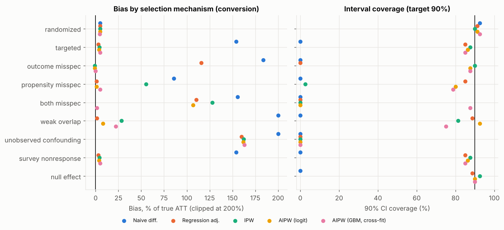
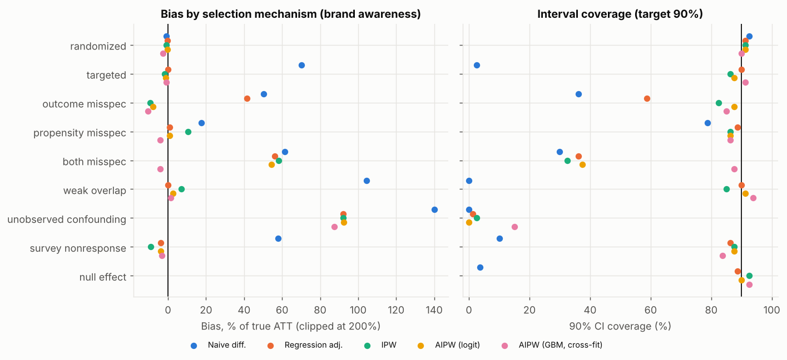
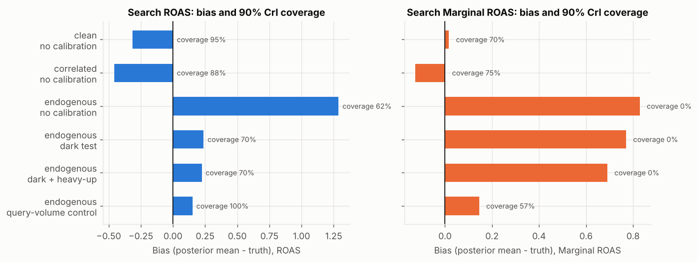
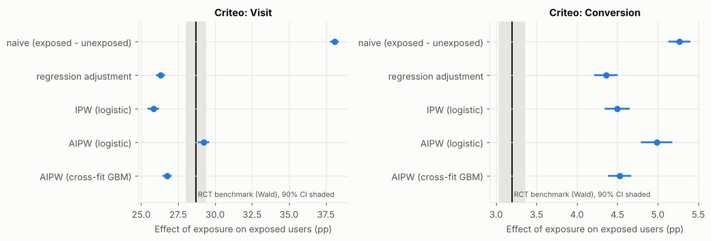
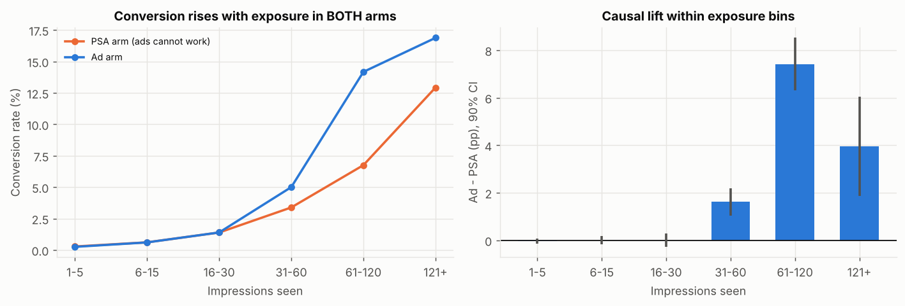
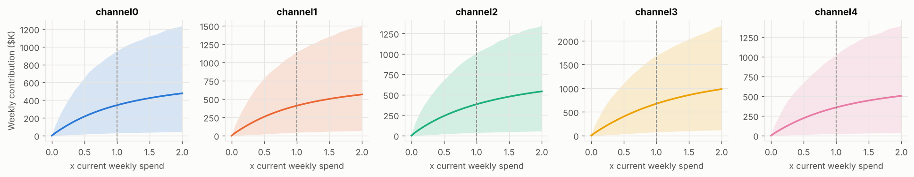
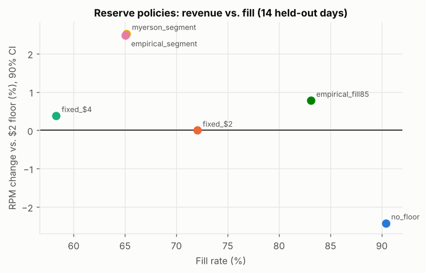
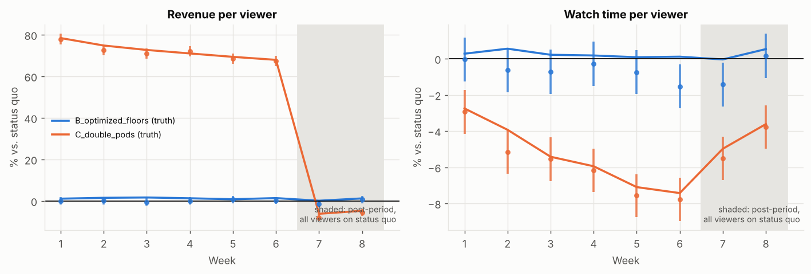

# adlift - results report

Generated by `adlift report` from saved results. All numbers are computed, not typed.

## 1. Incrementality estimators vs. known truth (Monte Carlo)

80 simulated campaigns per scenario, 20,000 users each. Target: ATT of exposure. Truth is exact (both potential outcomes are simulated).

**Conversion (observed for all users)**

| scenario | method | truth | bias | relative_bias | rmse | coverage | reject_rate |
|---|---|---|---|---|---|---|---|
| randomized | Naive diff. | 0.0256 | +0.0013 | +5% | 0.0043 | 92% | 100% |
| randomized | Regression adj. | 0.0256 | +0.0012 | +5% | 0.0041 | 91% | 100% |
| randomized | IPW | 0.0256 | +0.0013 | +5% | 0.0041 | 90% | 100% |
| randomized | AIPW (logit) | 0.0256 | +0.0012 | +5% | 0.0041 | 91% | 100% |
| randomized | AIPW (GBM, cross-fit) | 0.0256 | +0.0012 | +5% | 0.0043 | 92% | 100% |
| targeted | Naive diff. | 0.0326 | +0.0502 | +154% | 0.0504 | 0% | 100% |
| targeted | Regression adj. | 0.0326 | +0.0010 | +3% | 0.0066 | 85% | 100% |
| targeted | IPW | 0.0326 | +0.0013 | +4% | 0.0073 | 88% | 100% |
| targeted | AIPW (logit) | 0.0326 | +0.0012 | +4% | 0.0074 | 86% | 100% |
| targeted | AIPW (GBM, cross-fit) | 0.0326 | +0.0015 | +5% | 0.0082 | 85% | 100% |
| outcome_misspec | Naive diff. | 0.0395 | +0.0726 | +184% | 0.0728 | 0% | 100% |
| outcome_misspec | Regression adj. | 0.0395 | +0.0458 | +116% | 0.0464 | 0% | 100% |
| outcome_misspec | IPW | 0.0395 | -0.0004 | -1% | 0.0091 | 90% | 99% |
| outcome_misspec | AIPW (logit) | 0.0395 | -0.0004 | -1% | 0.0091 | 88% | 99% |
| outcome_misspec | AIPW (GBM, cross-fit) | 0.0395 | -0.0001 | -0% | 0.0079 | 88% | 100% |
| propensity_misspec | Naive diff. | 0.0281 | +0.0241 | +86% | 0.0245 | 0% | 100% |
| propensity_misspec | Regression adj. | 0.0281 | +0.0003 | +1% | 0.0053 | 85% | 100% |
| propensity_misspec | IPW | 0.0281 | +0.0155 | +55% | 0.0161 | 2% | 100% |
| propensity_misspec | AIPW (logit) | 0.0281 | +0.0003 | +1% | 0.0053 | 80% | 100% |
| propensity_misspec | AIPW (GBM, cross-fit) | 0.0281 | +0.0014 | +5% | 0.0088 | 79% | 95% |
| both_misspec | Naive diff. | 0.0377 | +0.0586 | +156% | 0.0589 | 0% | 100% |
| both_misspec | Regression adj. | 0.0377 | +0.0415 | +110% | 0.0419 | 0% | 100% |
| both_misspec | IPW | 0.0377 | +0.0482 | +128% | 0.0485 | 0% | 100% |
| both_misspec | AIPW (logit) | 0.0377 | +0.0403 | +107% | 0.0407 | 0% | 100% |
| both_misspec | AIPW (GBM, cross-fit) | 0.0377 | +0.0006 | +2% | 0.0083 | 88% | 100% |
| weak_overlap | Naive diff. | 0.0366 | +0.0770 | +211% | 0.0773 | 0% | 100% |
| weak_overlap | Regression adj. | 0.0366 | +0.0005 | +1% | 0.0098 | 89% | 99% |
| weak_overlap | IPW | 0.0366 | +0.0104 | +28% | 0.0191 | 81% | 86% |
| weak_overlap | AIPW (logit) | 0.0366 | +0.0030 | +8% | 0.0159 | 92% | 76% |
| weak_overlap | AIPW (GBM, cross-fit) | 0.0366 | +0.0081 | +22% | 0.0174 | 75% | 88% |
| unobserved_confounding | Naive diff. | 0.0403 | +0.0962 | +239% | 0.0964 | 0% | 100% |
| unobserved_confounding | Regression adj. | 0.0403 | +0.0646 | +160% | 0.0648 | 0% | 100% |
| unobserved_confounding | IPW | 0.0403 | +0.0655 | +162% | 0.0658 | 0% | 100% |
| unobserved_confounding | AIPW (logit) | 0.0403 | +0.0653 | +162% | 0.0656 | 0% | 100% |
| unobserved_confounding | AIPW (GBM, cross-fit) | 0.0403 | +0.0658 | +163% | 0.0661 | 0% | 100% |
| survey_nonresponse | Naive diff. | 0.0326 | +0.0502 | +154% | 0.0504 | 0% | 100% |
| survey_nonresponse | Regression adj. | 0.0326 | +0.0010 | +3% | 0.0066 | 85% | 100% |
| survey_nonresponse | IPW | 0.0326 | +0.0013 | +4% | 0.0073 | 88% | 100% |
| survey_nonresponse | AIPW (logit) | 0.0326 | +0.0012 | +4% | 0.0074 | 86% | 100% |
| survey_nonresponse | AIPW (GBM, cross-fit) | 0.0326 | +0.0015 | +5% | 0.0082 | 85% | 100% |
| null_effect | Naive diff. | 0.0000 | +0.0504 |  | 0.0506 | 0% | 100% |
| null_effect | Regression adj. | 0.0000 | +0.0012 |  | 0.0059 | 89% | 11% |
| null_effect | IPW | 0.0000 | +0.0016 |  | 0.0067 | 92% | 8% |
| null_effect | AIPW (logit) | 0.0000 | +0.0014 |  | 0.0067 | 90% | 10% |
| null_effect | AIPW (GBM, cross-fit) | 0.0000 | +0.0018 |  | 0.0075 | 90% | 10% |

**Brand awareness (survey respondents only)**

| scenario | method | truth | bias | relative_bias | rmse | coverage | reject_rate |
|---|---|---|---|---|---|---|---|
| randomized | Naive diff. | 0.0967 | -0.0007 | -1% | 0.0202 | 92% | 100% |
| randomized | Regression adj. | 0.0967 | -0.0003 | -0% | 0.0212 | 91% | 100% |
| randomized | IPW | 0.0967 | -0.0009 | -1% | 0.0206 | 91% | 100% |
| randomized | AIPW (logit) | 0.0967 | -0.0003 | -0% | 0.0212 | 91% | 100% |
| randomized | AIPW (GBM, cross-fit) | 0.0967 | -0.0026 | -3% | 0.0247 | 90% | 99% |
| targeted | Naive diff. | 0.1032 | +0.0724 | +70% | 0.0754 | 2% | 100% |
| targeted | Regression adj. | 0.1032 | +0.0001 | +0% | 0.0250 | 90% | 100% |
| targeted | IPW | 0.1032 | -0.0018 | -2% | 0.0313 | 86% | 92% |
| targeted | AIPW (logit) | 0.1032 | -0.0011 | -1% | 0.0292 | 88% | 98% |
| targeted | AIPW (GBM, cross-fit) | 0.1032 | -0.0011 | -1% | 0.0355 | 91% | 86% |
| outcome_misspec | Naive diff. | 0.0900 | +0.0454 | +50% | 0.0511 | 36% | 100% |
| outcome_misspec | Regression adj. | 0.0900 | +0.0373 | +41% | 0.0455 | 59% | 100% |
| outcome_misspec | IPW | 0.0900 | -0.0083 | -9% | 0.0336 | 82% | 85% |
| outcome_misspec | AIPW (logit) | 0.0900 | -0.0072 | -8% | 0.0323 | 88% | 88% |
| outcome_misspec | AIPW (GBM, cross-fit) | 0.0900 | -0.0096 | -11% | 0.0372 | 85% | 76% |
| propensity_misspec | Naive diff. | 0.0965 | +0.0168 | +17% | 0.0278 | 79% | 100% |
| propensity_misspec | Regression adj. | 0.0965 | +0.0010 | +1% | 0.0233 | 89% | 100% |
| propensity_misspec | IPW | 0.0965 | +0.0102 | +11% | 0.0255 | 86% | 100% |
| propensity_misspec | AIPW (logit) | 0.0965 | +0.0009 | +1% | 0.0235 | 86% | 100% |
| propensity_misspec | AIPW (GBM, cross-fit) | 0.0965 | -0.0039 | -4% | 0.0384 | 86% | 84% |
| both_misspec | Naive diff. | 0.0842 | +0.0518 | +62% | 0.0568 | 30% | 100% |
| both_misspec | Regression adj. | 0.0842 | +0.0472 | +56% | 0.0534 | 36% | 100% |
| both_misspec | IPW | 0.0842 | +0.0491 | +58% | 0.0551 | 32% | 100% |
| both_misspec | AIPW (logit) | 0.0842 | +0.0457 | +54% | 0.0520 | 38% | 100% |
| both_misspec | AIPW (GBM, cross-fit) | 0.0842 | -0.0034 | -4% | 0.0389 | 88% | 75% |
| weak_overlap | Naive diff. | 0.1065 | +0.1113 | +104% | 0.1132 | 0% | 100% |
| weak_overlap | Regression adj. | 0.1065 | -0.0000 | -0% | 0.0332 | 90% | 95% |
| weak_overlap | IPW | 0.1065 | +0.0076 | +7% | 0.0727 | 85% | 59% |
| weak_overlap | AIPW (logit) | 0.1065 | +0.0027 | +3% | 0.0691 | 91% | 60% |
| weak_overlap | AIPW (GBM, cross-fit) | 0.1065 | +0.0016 | +2% | 0.0751 | 94% | 55% |
| unobserved_confounding | Naive diff. | 0.0981 | +0.1373 | +140% | 0.1388 | 0% | 100% |
| unobserved_confounding | Regression adj. | 0.0981 | +0.0903 | +92% | 0.0933 | 1% | 100% |
| unobserved_confounding | IPW | 0.0981 | +0.0903 | +92% | 0.0933 | 2% | 100% |
| unobserved_confounding | AIPW (logit) | 0.0981 | +0.0906 | +92% | 0.0936 | 0% | 100% |
| unobserved_confounding | AIPW (GBM, cross-fit) | 0.0981 | +0.0859 | +88% | 0.0922 | 15% | 100% |
| survey_nonresponse | Naive diff. | 0.1032 | +0.0599 | +58% | 0.0635 | 10% | 100% |
| survey_nonresponse | Regression adj. | 0.1032 | -0.0039 | -4% | 0.0239 | 86% | 99% |
| survey_nonresponse | IPW | 0.1032 | -0.0092 | -9% | 0.0274 | 88% | 95% |
| survey_nonresponse | AIPW (logit) | 0.1032 | -0.0038 | -4% | 0.0251 | 88% | 99% |
| survey_nonresponse | AIPW (GBM, cross-fit) | 0.1032 | -0.0034 | -3% | 0.0350 | 84% | 94% |
| null_effect | Naive diff. | 0.0000 | +0.0725 |  | 0.0754 | 4% | 96% |
| null_effect | Regression adj. | 0.0000 | +0.0003 |  | 0.0238 | 89% | 11% |
| null_effect | IPW | 0.0000 | -0.0016 |  | 0.0306 | 92% | 8% |
| null_effect | AIPW (logit) | 0.0000 | -0.0009 |  | 0.0280 | 90% | 10% |
| null_effect | AIPW (GBM, cross-fit) | 0.0000 | -0.0016 |  | 0.0339 | 92% | 8% |

**Winner's curse.** Picking the age segment with the largest estimated conversion lift:

| scenario | overstatement | overstatement_pct | top_is_truly_best | segment_ci_coverage |
|---|---|---|---|---|
| both_misspec | +0.0479 | +89% | 54% | 7% |
| null_effect | +0.0185 | +inf% | 100% | 89% |
| outcome_misspec | +0.0149 | +27% | 45% | 90% |
| propensity_misspec | +0.0054 | +13% | 68% | 89% |
| randomized | +0.0069 | +19% | 57% | 91% |
| survey_nonresponse | +0.0123 | +27% | 56% | 88% |
| targeted | +0.0123 | +27% | 56% | 88% |
| unobserved_confounding | +0.0703 | +124% | 61% | 0% |
| weak_overlap | +0.0352 | +76% | 38% | 86% |

## 2. Bayesian MMM vs. known truth (Monte Carlo)

40 simulated advertisers x 156 weeks x 4 channels; 6 fitting conditions per seed. Truth: exact ROAS and marginal ROAS from the simulator.

| scenario | calibration | metric | channel | truth | bias | rmse | coverage | width |
|---|---|---|---|---|---|---|---|---|
| clean | none | roas | youtube | 2.20 | -0.01 | 0.86 | 78% | 2.40 |
| clean | none | mroas | youtube | 1.48 | -0.18 | 0.55 | 62% | 1.12 |
| clean | none | roas | search | 2.97 | -0.31 | 0.70 | 95% | 2.87 |
| clean | none | mroas | search | 1.56 | +0.02 | 0.29 | 70% | 0.68 |
| clean | none | roas | social | 1.40 | +0.43 | 1.14 | 92% | 3.35 |
| clean | none | mroas | social | 0.92 | +0.07 | 0.55 | 82% | 1.39 |
| clean | none | roas | display | 0.70 | +1.10 | 1.60 | 90% | 4.02 |
| clean | none | mroas | display | 0.30 | +0.68 | 0.93 | 78% | 1.80 |
| correlated | none | roas | youtube | 2.20 | -0.20 | 0.78 | 78% | 2.16 |
| correlated | none | mroas | youtube | 1.48 | -0.35 | 0.55 | 72% | 1.17 |
| correlated | none | roas | search | 2.97 | -0.46 | 1.03 | 88% | 3.27 |
| correlated | none | mroas | search | 1.56 | -0.13 | 0.51 | 75% | 1.13 |
| correlated | none | roas | social | 1.40 | +0.34 | 1.07 | 95% | 3.98 |
| correlated | none | mroas | social | 0.92 | +0.05 | 0.65 | 92% | 1.86 |
| correlated | none | roas | display | 0.70 | +2.14 | 2.89 | 80% | 6.29 |
| correlated | none | mroas | display | 0.30 | +1.24 | 1.61 | 72% | 2.90 |
| endogenous | none | roas | youtube | 2.20 | +0.12 | 0.82 | 85% | 2.26 |
| endogenous | none | mroas | youtube | 1.48 | -0.21 | 0.54 | 60% | 0.96 |
| endogenous | none | roas | search | 2.97 | +1.29 | 1.45 | 62% | 3.13 |
| endogenous | none | mroas | search | 1.56 | +0.83 | 0.86 | 0% | 0.45 |
| endogenous | none | roas | social | 1.40 | +1.26 | 1.54 | 80% | 3.81 |
| endogenous | none | mroas | social | 0.92 | +0.54 | 0.72 | 65% | 1.32 |
| endogenous | none | roas | display | 0.70 | +0.37 | 0.82 | 95% | 2.70 |
| endogenous | none | mroas | display | 0.30 | +0.29 | 0.51 | 95% | 1.28 |
| endogenous | dark test | roas | youtube | 2.20 | +0.12 | 0.79 | 82% | 2.26 |
| endogenous | dark test | mroas | youtube | 1.48 | -0.21 | 0.53 | 62% | 0.96 |
| endogenous | dark test | roas | search | 2.97 | +0.24 | 0.51 | 70% | 1.04 |
| endogenous | dark test | mroas | search | 1.56 | +0.77 | 0.80 | 0% | 0.43 |
| endogenous | dark test | roas | social | 1.40 | +1.34 | 1.58 | 75% | 3.85 |
| endogenous | dark test | mroas | social | 0.92 | +0.57 | 0.73 | 65% | 1.31 |
| endogenous | dark test | roas | display | 0.70 | +0.39 | 0.88 | 95% | 2.68 |
| endogenous | dark test | mroas | display | 0.30 | +0.31 | 0.55 | 95% | 1.32 |
| endogenous | dark + heavy-up | roas | youtube | 2.20 | +0.11 | 0.80 | 80% | 2.23 |
| endogenous | dark + heavy-up | mroas | youtube | 1.48 | -0.21 | 0.54 | 62% | 0.96 |
| endogenous | dark + heavy-up | roas | search | 2.97 | +0.22 | 0.51 | 70% | 1.03 |
| endogenous | dark + heavy-up | mroas | search | 1.56 | +0.69 | 0.72 | 0% | 0.40 |
| endogenous | dark + heavy-up | roas | social | 1.40 | +1.46 | 1.69 | 75% | 4.08 |
| endogenous | dark + heavy-up | mroas | social | 0.92 | +0.63 | 0.77 | 62% | 1.32 |
| endogenous | dark + heavy-up | roas | display | 0.70 | +0.48 | 0.97 | 95% | 2.94 |
| endogenous | dark + heavy-up | mroas | display | 0.30 | +0.34 | 0.58 | 95% | 1.36 |
| endogenous | query-volume control | roas | youtube | 2.20 | +0.17 | 0.41 | 98% | 1.87 |
| endogenous | query-volume control | mroas | youtube | 1.48 | -0.13 | 0.26 | 82% | 0.70 |
| endogenous | query-volume control | roas | search | 2.97 | +0.15 | 0.47 | 100% | 2.56 |
| endogenous | query-volume control | mroas | search | 1.56 | +0.15 | 0.17 | 57% | 0.37 |
| endogenous | query-volume control | roas | social | 1.40 | +0.62 | 0.85 | 92% | 2.94 |
| endogenous | query-volume control | mroas | social | 0.92 | +0.16 | 0.36 | 80% | 0.95 |
| endogenous | query-volume control | roas | display | 0.70 | +0.27 | 0.48 | 100% | 2.26 |
| endogenous | query-volume control | mroas | display | 0.30 | +0.23 | 0.32 | 95% | 1.04 |

**Budget reallocation scored with the true curves** (share of the truly achievable gain captured by the model's recommendation; negative = the recommendation loses money):

| scenario | calibration | median | p_positive | max_rhat | median_divergences |
|---|---|---|---|---|---|
| clean | none | +38% | 65% | 1.379 | 2 |
| correlated | none | -60% | 35% | 1.143 | 5 |
| endogenous | none | +42% | 70% | 1.061 | 1 |
| endogenous | dark test | +39% | 72% | 1.049 | 2 |
| endogenous | dark + heavy-up | +35% | 68% | 1.139 | 3 |
| endogenous | query-volume control | +86% | 100% | 1.034 | 1 |

## 3. Real data: Criteo randomized ad test (LaLonde-style)

Rows: 13,979,592. Treatment share 0.8500 (design 0.85; SRM p = 0.999). Exposed users in control: 0. Null cells: 0.

**Experimental benchmark (all users):**

| outcome | itt | itt_se | itt_relative | exposure_rate_treated | tot | tot_se | tot_ci_low | tot_ci_high | tot_relative |
|---|---|---|---|---|---|---|---|---|---|
| visit | 0.01034 | 0.00015 | +27.1% | 3.60% | 0.2870 | 0.0040 | 0.2804 | 0.2936 | +225% |
| conversion | 0.00115 | 0.00003 | +59.4% | 3.60% | 0.0320 | 0.0010 | 0.0304 | 0.0335 | +146% |

**Observational re-analysis** (treatment arm only, 2,000,000 sampled users, 72,140 exposed; control arm discarded):

| outcome | method | estimate | se | rct_tot | ratio_to_rct | z_vs_rct |
|---|---|---|---|---|---|---|
| visit | naive (exposed - unexposed) | 0.3808 | 0.0018 | 0.2870 | 1.33x | +21.2 |
| visit | regression adjustment | 0.2630 | 0.0018 | 0.2870 | 0.92x | -5.4 |
| visit | IPW (logistic) | 0.2582 | 0.0024 | 0.2870 | 0.90x | -6.2 |
| visit | AIPW (logistic) | 0.2922 | 0.0024 | 0.2870 | 1.02x | +1.1 |
| visit | AIPW (cross-fit GBM) | 0.2675 | 0.0018 | 0.2870 | 0.93x | -4.4 |
| conversion | naive (exposed - unexposed) | 0.0527 | 0.0008 | 0.0320 | 1.65x | +16.3 |
| conversion | regression adjustment | 0.0436 | 0.0009 | 0.0320 | 1.36x | +8.9 |
| conversion | IPW (logistic) | 0.0450 | 0.0010 | 0.0320 | 1.41x | +9.7 |
| conversion | AIPW (logistic) | 0.0499 | 0.0012 | 0.0320 | 1.56x | +11.7 |
| conversion | AIPW (cross-fit GBM) | 0.0453 | 0.0009 | 0.0320 | 1.42x | +10.4 |

Overlap (estimated propensity of exposure):

| arm | n | p5 | p50 | p95 | p99 | share_below_0.05 | share_above_0.95 |
|---|---|---|---|---|---|---|---|
| exposed | 72140 | 0.0093 | 0.2159 | 0.676 | 0.839 | 16.6% | 0.0% |
| unexposed | 1927860 | 0.0010 | 0.0039 | 0.149 | 0.370 | 86.5% | 0.0% |

Largest covariate imbalances (SMD, before / after ATT weighting):

| covariate | smd_unweighted | smd_weighted |
|---|---|---|
| f3 | -1.47 | -0.21 |
| f6 | -1.38 | -0.20 |
| f8 | -1.01 | -0.17 |
| f9 | +0.88 | +0.14 |
| f0 | -0.85 | -0.13 |
| f5 | -0.63 | -0.10 |

**Heterogeneity (visit): ITT by quintile of baseline visit propensity** (top minus bottom: +3.77pp +/- 0.24pp):

| score_quintile | n | baseline_rate | itt | se | relative | qvalue_bh |
|---|---|---|---|---|---|---|
| 1 | 6e+05 | 0.0007 | 0.00005 | 0.00009 | +8% | 0.57 |
| 2 | 6e+05 | 0.0005 | 0.00034 | 0.00009 | +62% | 0.00015 |
| 3 | 6e+05 | 0.0027 | 0.00120 | 0.00019 | +45% | 8.5e-10 |
| 4 | 6e+05 | 0.0116 | 0.00261 | 0.00039 | +22% | 6.8e-11 |
| 5 | 6e+05 | 0.1852 | 0.03773 | 0.00145 | +20% | 3.4e-149 |

**Heterogeneity (conversion): ITT by quintile of baseline conversion propensity** (top minus bottom: +0.40pp +/- 0.06pp):

| score_quintile | n | baseline_rate | itt | se | relative | qvalue_bh |
|---|---|---|---|---|---|---|
| 1 | 6e+05 | 0.0020 | 0.00067 | 0.00016 | +34% | 0.00011 |
| 2 | 6e+05 | 0.0001 | 0.00009 | 0.00004 | +79% | 0.029 |
| 3 | 6e+05 | 0.0001 | 0.00010 | 0.00003 | +126% | 0.006 |
| 4 | 6e+05 | 0.0003 | 0.00022 | 0.00007 | +73% | 0.0015 |
| 5 | 6e+05 | 0.0075 | 0.00464 | 0.00033 | +62% | 3.2e-44 |

## 4. Real data: ads vs. PSA experiment

588,101 users (23,524 PSA). Lift +0.77pp (90% CI +0.62pp to +0.92pp), +43% relative (1.79% -> 2.55%).

**Activity bias.** Heavy- vs. light-exposure users (median split): ad arm +4.43pp, PSA arm +2.97pp. 67% of the naive gap appears where ads cannot work.

| ads_bin | n | n_psa | psa_rate | ad_rate | lift | se | relative | qvalue_bh |
|---|---|---|---|---|---|---|---|---|
| 1-5 | 177823 | 7861 | 0.0028 | 0.0025 | -0.0003 | 0.0006 | -10% | 0.96 |
| 6-15 | 151679 | 5578 | 0.0061 | 0.0061 | -0.0000 | 0.0011 | -1% | 0.98 |
| 16-30 | 127879 | 4959 | 0.0139 | 0.0140 | +0.0000 | 0.0017 | +0% | 0.98 |
| 31-60 | 77335 | 2865 | 0.0339 | 0.0500 | +0.0162 | 0.0035 | +48% | 9.5e-06 |
| 61-120 | 36883 | 1526 | 0.0675 | 0.1417 | +0.0742 | 0.0067 | +110% | 7.5e-28 |
| 121+ | 16502 | 735 | 0.1293 | 0.1688 | +0.0395 | 0.0127 | +31% | 0.0038 |

**Randomization checks and sensitivity.** Arms differ in day/hour mix, so lift is re-estimated with adjustment:

| check | statistic | pvalue |
|---|---|---|
| total_ads distribution (KS test) | 0.0397 | 2.3e-31 |
| most_ads_day distribution (chi-square) | 235.6 | 4.8e-48 |
| mean total_ads ad - psa | 0.06223 | 0.83 |

| most_ads_day | psa_share | ad_share | difference_pp |
|---|---|---|---|
| Monday | 0.149 | 0.148 | -0.08 |
| Tuesday | 0.124 | 0.132 | +0.85 |
| Wednesday | 0.148 | 0.137 | -1.12 |
| Thursday | 0.166 | 0.140 | -2.59 |
| Friday | 0.162 | 0.157 | -0.44 |
| Saturday | 0.121 | 0.140 | +1.81 |
| Sunday | 0.130 | 0.146 | +1.58 |

| adjustment | lift | se | ci_low | ci_high | relative | pvalue |
|---|---|---|---|---|---|---|
| none | +0.00769 | 0.00089 | +0.00623 | +0.00915 | +43.1% | 4.8e-18 |
| day + hour | +0.00788 | 0.00089 | +0.00642 | +0.00933 | +44.6% | 5.8e-19 |
| day + hour + exposure bin | +0.00800 | 0.00087 | +0.00657 | +0.00942 | +45.5% | 2.8e-20 |

## 5. Campaign measurement pipeline (SQL + diagnostics + brand lift)

One simulated 16-campaign flight, 200,000 users, raw logs with injected defects, processed by the DuckDB SQL layer.

**Raw-data quality checks** (rows removed by staging):

| check_name | failing | total | failing_rate |
|---|---|---|---|
| duplicate_impression_rows | 1151 | 231789 | 0.50% |
| impressions_outside_flight | 460 | 231789 | 0.20% |
| impressions_unknown_user | 0 | 231789 | 0.00% |
| conversions_null_user | 25 | 71049 | 0.04% |
| survey_from_uninvited_or_unknown | 30 | 47865 | 0.06% |
| survey_answer_out_of_domain | 3 | 47865 | 0.01% |
| users_duplicate_id | 0 | 200000 | 0.00% |
| campaign_window_invalid | 0 | 16 | 0.00% |

**Analysis-table checks** (all must be 0):

| check_name | failing | total |
|---|---|---|
| analysis_duplicate_users | 0 | 200000 |
| frequency_above_cap | 0 | 200000 |
| exposed_flag_inconsistent | 0 | 200000 |
| response_without_invite | 0 | 200000 |
| binary_outcome_out_of_domain | 0 | 200000 |
| affinity_out_of_unit_interval | 0 | 200000 |

**Missingness:**

| column | missing_rate | missing_rate[device=desktop] | missing_rate[device=mobile] | chi2_p[device] | missing_rate[exposed=0] | missing_rate[exposed=1] | chi2_p[exposed] |
|---|---|---|---|---|---|---|---|
| income | 0.159 | 0.082 | 0.200 | 0.000 | 0.157 | 0.162 | 0.002 |
| aware | 0.880 | 0.883 | 0.879 | 0.029 | 0.914 | 0.831 | 0.000 |
| intent | 0.880 | 0.883 | 0.879 | 0.029 | 0.914 | 0.831 | 0.000 |

**Survey response:** 56.1% of invited exposed users responded vs. 28.7% unexposed (p = 0).

**Balance** (top covariates by |SMD|):

| covariate | smd_unweighted | smd_weighted |
|---|---|---|
| log_sessions | +0.71 | +0.002 |
| affinity_logit | +0.49 | +0.003 |
| prior_purchaser=1 | +0.32 | +0.000 |
| campaign_id=C15 | +0.12 | +0.009 |
| campaign_id=C10 | -0.12 | -0.002 |
| device=mobile | +0.11 | +0.004 |

**Effects vs. truth:**

| outcome | method | estimate | ci_low | ci_high | relative | truth | covered |
|---|---|---|---|---|---|---|---|
| converted | difference_in_means | +0.0836 | +0.0812 | +0.0860 | +133% | +0.0353 | False |
| converted | regression_adjustment | +0.0356 | +0.0324 | +0.0389 | +32% | +0.0353 | True |
| converted | ipw | +0.0351 | +0.0315 | +0.0387 | +31% | +0.0353 | True |
| converted | aipw_parametric | +0.0346 | +0.0312 | +0.0381 | +31% | +0.0353 | True |
| converted | aipw_ml | +0.0348 | +0.0314 | +0.0382 | +31% | +0.0353 | True |
| aware | difference_in_means | +0.1839 | +0.1733 | +0.1944 | +48% | +0.1138 | False |
| aware | regression_adjustment | +0.1170 | +0.1051 | +0.1288 | +27% | +0.1138 | True |
| aware | ipw | +0.1106 | +0.0980 | +0.1232 | +26% | +0.1138 | True |
| aware | aipw_parametric | +0.1174 | +0.1052 | +0.1297 | +27% | +0.1138 | True |
| aware | aipw_ml | +0.1175 | +0.1051 | +0.1298 | +27% | +0.1138 | True |
| intent | difference_in_means | +0.1005 | +0.0918 | +0.1092 | +61% | +0.0362 | False |
| intent | regression_adjustment | +0.0404 | +0.0302 | +0.0506 | +19% | +0.0362 | True |
| intent | ipw | +0.0371 | +0.0264 | +0.0479 | +18% | +0.0362 | True |
| intent | aipw_parametric | +0.0422 | +0.0317 | +0.0527 | +21% | +0.0362 | True |
| intent | aipw_ml | +0.0455 | +0.0350 | +0.0560 | +22% | +0.0362 | True |

**Brand-lift KPIs (awareness, AIPW-GBM):** absolute lift +11.7pp; lifted users 9,431 (90% CI 8,441 to 10,422; truth 9,140); cost per lifted user $0.33 on $3,082 spend.

Segment effects - converted by age_group (BH q-values; truth from simulator):

| segment | n_exposed | estimate | ci_low | ci_high | qvalue_bh | truth | covered |
|---|---|---|---|---|---|---|---|
| 18-24 | 12198 | +0.0523 | +0.0439 | +0.0607 | 2.4e-24 | +0.0489 | True |
| 25-34 | 22028 | +0.0526 | +0.0460 | +0.0591 | 5.6e-39 | +0.0518 | True |
| 35-44 | 18854 | +0.0212 | +0.0139 | +0.0285 | 2.8e-06 | +0.0255 | True |
| 45-54 | 14918 | +0.0227 | +0.0146 | +0.0308 | 5.4e-06 | +0.0238 | True |
| 55+ | 12301 | +0.0211 | +0.0129 | +0.0294 | 2.4e-05 | +0.0213 | True |

Segment effects - converted by campaign_id (BH q-values; truth from simulator):

| segment | n_exposed | estimate | ci_low | ci_high | qvalue_bh | truth | covered |
|---|---|---|---|---|---|---|---|
| C00 | 4244 | +0.0354 | +0.0218 | +0.0491 | 3.6e-05 | +0.0325 | True |
| C01 | 5057 | +0.0422 | +0.0289 | +0.0555 | 5.8e-07 | +0.0468 | True |
| C02 | 5347 | +0.0449 | +0.0324 | +0.0573 | 2.4e-08 | +0.0401 | True |
| C03 | 4382 | +0.0322 | +0.0188 | +0.0456 | 0.00012 | +0.0401 | True |
| C04 | 5115 | +0.0468 | +0.0323 | +0.0612 | 4.3e-07 | +0.0421 | True |
| C05 | 5573 | +0.0391 | +0.0262 | +0.0520 | 1.6e-06 | +0.0298 | True |
| C06 | 5205 | +0.0296 | +0.0165 | +0.0428 | 0.00028 | +0.0389 | True |
| C07 | 5363 | +0.0304 | +0.0173 | +0.0435 | 0.00019 | +0.0362 | True |
| C08 | 5219 | +0.0396 | +0.0253 | +0.0538 | 1.2e-05 | +0.0253 | True |
| C09 | 3923 | +0.0382 | +0.0243 | +0.0522 | 1.4e-05 | +0.0302 | True |
| C10 | 3704 | +0.0252 | +0.0119 | +0.0384 | 0.0022 | +0.0220 | True |
| C11 | 5573 | +0.0494 | +0.0352 | +0.0635 | 5.2e-08 | +0.0542 | True |
| C12 | 5244 | +0.0157 | +0.0008 | +0.0306 | 0.089 | +0.0322 | False |
| C13 | 4361 | +0.0699 | +0.0563 | +0.0836 | 4.8e-16 | +0.0589 | True |
| C14 | 5532 | +0.0126 | -0.0014 | +0.0266 | 0.14 | +0.0173 | True |
| C15 | 6457 | +0.0141 | +0.0014 | +0.0269 | 0.077 | +0.0212 | True |

Segment effects - aware by age_group (BH q-values; truth from simulator):

| segment | n_exposed | estimate | ci_low | ci_high | qvalue_bh | truth | covered |
|---|---|---|---|---|---|---|---|
| 18-24 | 12198 | +0.1316 | +0.1005 | +0.1627 | 6e-12 | +0.1353 | True |
| 25-34 | 22028 | +0.1407 | +0.1177 | +0.1638 | 4.9e-23 | +0.1348 | True |
| 35-44 | 18854 | +0.0977 | +0.0719 | +0.1236 | 6.2e-10 | +0.1038 | True |
| 45-54 | 14918 | +0.1205 | +0.0921 | +0.1489 | 6e-12 | +0.1034 | True |
| 55+ | 12301 | +0.0874 | +0.0547 | +0.1200 | 1.1e-05 | +0.0829 | True |

Segment effects - aware by campaign_id (BH q-values; truth from simulator):

| segment | n_exposed | estimate | ci_low | ci_high | qvalue_bh | truth | covered |
|---|---|---|---|---|---|---|---|
| C00 | 4244 | +0.1003 | +0.0508 | +0.1497 | 0.0014 | +0.0748 | True |
| C01 | 5057 | +0.1427 | +0.0935 | +0.1920 | 5e-06 | +0.1130 | True |
| C02 | 5347 | +0.1977 | +0.1478 | +0.2476 | 5.9e-10 | +0.1933 | True |
| C03 | 4382 | +0.0489 | +0.0019 | +0.0960 | 0.1 | +0.0966 | False |
| C04 | 5115 | +0.1572 | +0.1079 | +0.2066 | 5.2e-07 | +0.1084 | True |
| C05 | 5573 | +0.0771 | +0.0272 | +0.1271 | 0.015 | +0.0948 | True |
| C06 | 5205 | +0.2073 | +0.1588 | +0.2559 | 3.5e-11 | +0.1859 | True |
| C07 | 5363 | +0.1188 | +0.0658 | +0.1718 | 0.00045 | +0.1124 | True |
| C08 | 5219 | +0.0406 | -0.0064 | +0.0877 | 0.16 | +0.0558 | True |
| C09 | 3923 | +0.1405 | +0.0898 | +0.1912 | 1.2e-05 | +0.1561 | True |
| C10 | 3704 | +0.0561 | +0.0073 | +0.1048 | 0.072 | +0.0751 | True |
| C11 | 5573 | +0.1787 | +0.1317 | +0.2256 | 2.1e-09 | +0.1743 | True |
| C12 | 5244 | +0.1797 | +0.1315 | +0.2279 | 3.4e-09 | +0.1456 | True |
| C13 | 4361 | +0.1040 | +0.0555 | +0.1525 | 0.00074 | +0.1303 | True |
| C14 | 5532 | +0.0905 | +0.0422 | +0.1387 | 0.003 | +0.0351 | False |
| C15 | 6457 | +0.0434 | -0.0077 | +0.0944 | 0.16 | +0.0715 | True |

Campaign meta-regression (converted; 16 campaigns, descriptive):

| term | coef | se | z |
|---|---|---|---|
| intercept | +0.0295 | 0.0050 | +5.9 |
| creative_score | +0.0111 | 0.0033 | +3.4 |
| format_native | +0.0035 | 0.0069 | +0.5 |
| format_video | -0.0024 | 0.0074 | -0.3 |
| objective_consideration | +0.0024 | 0.0056 | +0.4 |

Campaign meta-regression (aware; 16 campaigns, descriptive):

| term | coef | se | z |
|---|---|---|---|
| intercept | +0.0766 | 0.0178 | +4.3 |
| creative_score | +0.0080 | 0.0110 | +0.7 |
| format_native | +0.0369 | 0.0237 | +1.6 |
| format_video | +0.1014 | 0.0247 | +4.1 |
| objective_consideration | -0.0120 | 0.0189 | -0.6 |

**Frequency:** naive (exposed at frequency f minus unexposed) vs. true effect at f:

| frequency | n | naive_effect | true_effect |
|---|---|---|---|
| 1 | 1.471e+04 | +0.0333 | +0.0144 |
| 2 | 2.157e+04 | +0.0603 | +0.0275 |
| 3 | 2.274e+04 | +0.0932 | +0.0387 |
| 4 | 9947 | +0.1060 | +0.0481 |
| 5 | 5709 | +0.1285 | +0.0543 |
| 6 | 4432 | +0.1754 | +0.0637 |
| 7 | 654 | +0.1756 | +0.0629 |
| 8 | 281 | +0.2289 | +0.0671 |
| 9 | 140 | +0.2585 | +0.0731 |
| 10 | 108 | +0.1963 | +0.0839 |

## 6. Bayesian MMM on Google Meridian's public data

156 weeks, 5 channels, aggregated from 40 geos in SQL. Diagnostics: max R-hat 1.012, min ESS 246, divergences 4. Train MAPE 4.5%; 13-week holdout MAPE 4.0% vs. 5.4% for a naive forecast. Media share of revenue: 25%.

| channel | spend_share | roas_mean | roas_low | roas_high | mroas_mean | mroas_low | mroas_high | p_mroas_above_1 |
|---|---|---|---|---|---|---|---|---|
| channel0 | 18% | 1.31 | 0.11 | 3.65 | 0.75 | 0.06 | 1.97 | 27% |
| channel1 | 14% | 1.99 | 0.21 | 5.61 | 1.12 | 0.13 | 2.96 | 44% |
| channel2 | 6% | 4.58 | 0.41 | 12.15 | 2.60 | 0.25 | 6.46 | 76% |
| channel3 | 40% | 1.18 | 0.13 | 2.97 | 0.76 | 0.09 | 1.89 | 29% |
| channel4 | 22% | 1.15 | 0.07 | 3.30 | 0.68 | 0.05 | 1.89 | 23% |

**Reallocation (same budget, each channel within +/-50%):** expected +$71,734/week (+0.85% of revenue), 90% interval $-67,987 to $234,138, P(gain > 0) = 78%.

| channel | current_weekly | recommended_weekly | change_pct |
|---|---|---|---|
| channel0 | $259,626 | $224,817 | -13% |
| channel1 | $200,771 | $263,313 | +31% |
| channel2 | $77,432 | $116,148 | +50% |
| channel3 | $563,207 | $532,826 | -5% |
| channel4 | $305,966 | $269,900 | -12% |

## 7. Auction study: reserve prices

60 advertisers, 100K opportunities/day, 15 segments; policies fit on day 0, evaluated on 14 held-out days (paired by day).

| format | policy | rpm | rpm_lift_pct | rpm_lift_ci_low_pct | rpm_lift_ci_high_pct | offline_predicted_lift_pct | fill_rate | advertiser_surplus_per_1k | welfare_per_1k | avg_winner_quality | budget_utilization |
|---|---|---|---|---|---|---|---|---|---|---|---|
| second | no_floor | $5.116 | -2.42% | -2.45% | -2.39% | -3.95% | 90.4% | $7.60 | $12.72 | +0.152 | 85.3% |
| second | fixed_$2 | $5.243 | +0.00% | +0.00% | +0.00% | +0.12% | 72.0% | $7.22 | $12.47 | +0.158 | 87.5% |
| second | fixed_$4 | $5.263 | +0.38% | +0.34% | +0.42% | +0.32% | 58.3% | $6.74 | $12.00 | +0.163 | 87.8% |
| second | myerson_segment | $5.375 | +2.52% | +2.47% | +2.57% | +3.55% | 65.1% | $6.52 | $11.90 | +0.174 | 89.7% |
| second | empirical_segment | $5.373 | +2.48% | +2.42% | +2.54% | +3.46% | 65.1% | $6.48 | $11.85 | +0.176 | 89.6% |
| second | empirical_fill85 | $5.284 | +0.78% | +0.74% | +0.82% | +0.96% | 83.1% | $7.06 | $12.35 | +0.165 | 88.1% |
| first | fixed_$2 | $5.179 | -1.21% | -1.29% | -1.13% |  | 59.1% | $6.87 | $12.04 | +0.154 | 86.4% |
| first | no_floor | $5.200 | -0.82% | -0.89% | -0.74% |  | 90.3% | $7.50 | $12.70 | +0.144 | 86.7% |
| first | myerson_segment | $4.877 | -6.98% | -7.08% | -6.87% |  | 41.4% | $5.12 | $10.00 | +0.172 | 81.4% |

Myerson floors by segment (thin markets first):

| segment | avg_bidders | revenue_lift_pct | fill_rate |
|---|---|---|---|
| T3/news | 0.88 | +66.0% | 31% |
| T3/education | 1.18 | -0.4% | 41% |
| T3/music | 1.50 | +7.2% | 45% |
| T2/news | 1.50 | -1.2% | 48% |
| T3/gaming | 1.51 | +5.0% | 45% |
| T2/education | 1.96 | +5.3% | 55% |
| T3/beauty | 1.97 | -0.8% | 56% |
| T1/news | 2.24 | +6.6% | 63% |
| T2/music | 2.96 | +1.0% | 71% |
| T2/gaming | 3.32 | +1.0% | 75% |
| T2/beauty | 3.72 | +1.7% | 79% |
| T1/education | 3.77 | +3.5% | 79% |
| T1/gaming | 4.19 | +2.2% | 83% |
| T1/music | 4.24 | +2.5% | 82% |
| T1/beauty | 4.31 | +1.9% | 84% |

Advertiser surplus vs. status quo:

| policy | budget_constrained | median_surplus_change | share_worse_off |
|---|---|---|---|
| empirical_fill85 | False | -2.9% | 61% |
| empirical_fill85 | True | -5.3% | 62% |
| empirical_segment | False | -13.5% | 100% |
| empirical_segment | True | -15.4% | 100% |
| fixed_$4 | False | -7.6% | 100% |
| fixed_$4 | True | -8.3% | 100% |
| myerson_segment | False | -12.6% | 100% |
| myerson_segment | True | -15.4% | 100% |
| no_floor | False | +4.2% | 22% |
| no_floor | True | +6.4% | 17% |

## 8. Viewer-experience guardrail experiment

3-arm user-randomized test, 6 treatment weeks + 2 post weeks; CUPED-style regression adjustment on 2 pre-period weeks. Truth from simulating every viewer under every arm.

| arm | metric | week1_relative_pct | week6_relative_pct | post_period_relative_pct | week1_estimate_pct | week6_estimate_pct |
|---|---|---|---|---|---|---|
| B_optimized_floors | revenue | +1.07% | +1.35% | +0.64% | +0.00% | +0.23% |
| B_optimized_floors | watch_minutes | +0.27% | +0.11% | +0.24% | -0.04% | -1.53% |
| B_optimized_floors | sessions | +0.00% | -0.07% | +0.17% | -0.11% | -1.11% |
| C_double_pods | revenue | +78.42% | +67.92% | -5.49% | +77.83% | +67.35% |
| C_double_pods | watch_minutes | -2.75% | -7.43% | -4.30% | -2.94% | -7.77% |
| C_double_pods | sessions | +0.00% | -3.30% | -3.20% | -0.41% | -3.43% |

| arm | ad_break_abandon_rate |
|---|---|
| A_status_quo | 2.19% |
| B_optimized_floors | 2.09% |
| C_double_pods | 3.47% |

**Interval coverage over 100 re-randomizations** (target 90%; the weekly cells above come from one split of the same viewers, so they move together):

| arm | metric | week | coverage | z_sd | draws |
|---|---|---|---|---|---|
| B_optimized_floors | revenue | 1 | 90% | 0.93 | 100 |
| B_optimized_floors | revenue | 6 | 92% | 0.88 | 100 |
| B_optimized_floors | watch_minutes | 1 | 95% | 0.85 | 100 |
| B_optimized_floors | watch_minutes | 6 | 92% | 0.87 | 100 |
| C_double_pods | revenue | 1 | 93% | 0.89 | 100 |
| C_double_pods | revenue | 6 | 95% | 0.87 | 100 |
| C_double_pods | watch_minutes | 1 | 95% | 0.88 | 100 |
| C_double_pods | watch_minutes | 6 | 94% | 0.87 | 100 |
